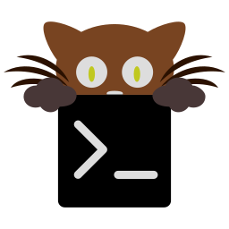
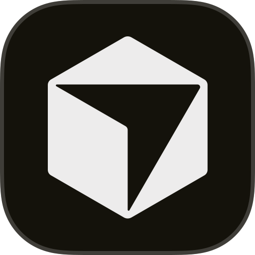
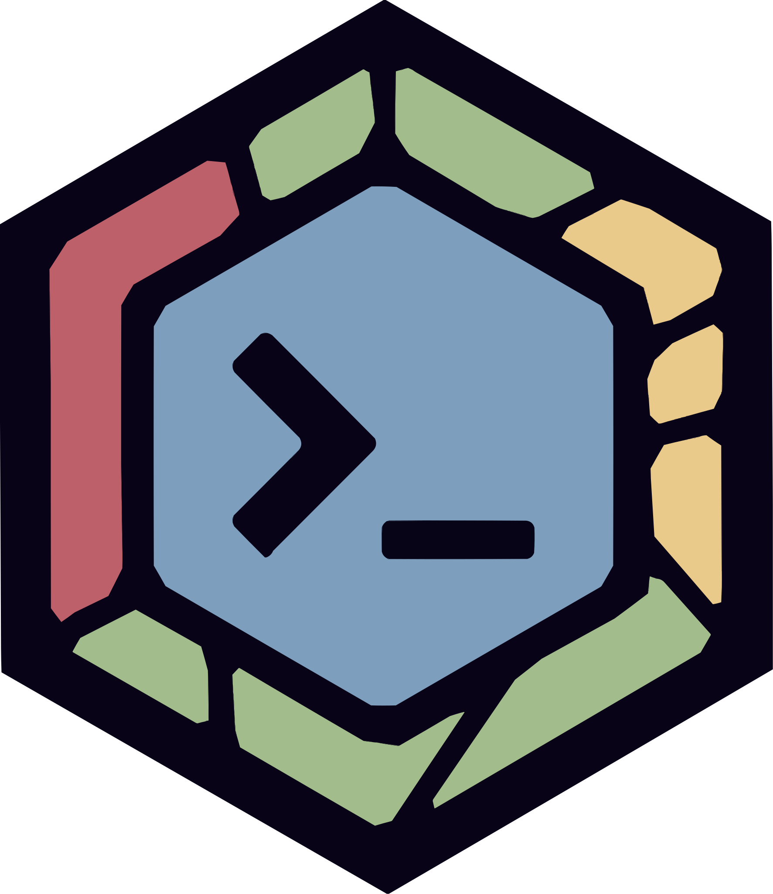

# Click-to-Focus

Use [shared OS path selection](CONFIGURATION.md#manual-configuration) and the [revision-checked settings recipe](../commands/settings.md). Examples show fields, not replacement documents. Keep unchanged by default, submit only requested leaf edits through private stdin, and ask for an explicit decision after CAS conflicts. Safe inspect omits free-form values; omission is not an instruction to reset them.

Clicking a notification activates your terminal window — no more hunting for the right window.

## Supported Terminals & IDEs

Quick reference. Precision levels: **pane/tab** targets the exact split or tab; **window** raises the whole app window (may land on the wrong tab if several are open); **best-effort** falls back to a generic name/title match that can pick the wrong window.

| App |  macOS | Notes |
|---|---|---|
|  **Ghostty** | ✅ Tab (AppleScript), window via AXDocument fallback | |
|  **iTerm2** | ✅ Tab/pane (Python API), otherwise app-level activation | Requires enabling iTerm2's Python API, then a restart |
|  **Warp** | ✅ Window/tab/pane via `WARP_FOCUS_URL` | No Accessibility/Screen Recording needed — Warp resolves its own window, tab, and pane |
|  **kitty** | ✅ Pane with remote control (`KITTY_LISTEN_ON`), window otherwise | Exact pane targeting needs kitty's remote control enabled |
|  **WezTerm** | ✅ Pane via `WEZTERM_PANE` | |
|  **VS Code** / Insiders | ✅ Window | |
|  **Cursor** | ✅ Window | |
|  **JetBrains IDEs** (IntelliJ IDEA, PhpStorm, WebStorm, PyCharm, GoLand, etc.) | ✅ Window | |
|  **Apple Terminal** | ✅ Window | Also the macOS fallback when no other terminal is detected |
|  **Alacritty** | ✅ Window | |
|  **Hyper** | ✅ Window | |
|  **tmux** | ✅ Pane/window | Also works inside iTerm2 `-CC` control mode via the Python API |
|  **zellij** | ✅ Tab | See [Multiplexers](#multiplexers) for `zellijFocus` tuning |
| Any other app | ✅ Window, via custom `terminalBundleId` | |

Legend: ✅ supported · ⚠️ best-effort / not officially documented · ❌ not supported
Logo sources and licenses are listed in [`assets/terminals/NOTICE`](assets/terminals/NOTICE).

## Configuration

In the shared file selected by `config path`:

```json
{
  "notifications": {
    "desktop": {
      "clickToFocus": true,
      "terminalBundleId": ""
    }
  }
}
```

| Option | Default | Description |
|--------|---------|-------------|
| `clickToFocus` | `true` | Enable click-to-focus on supported macOS terminals |
| `terminalBundleId` | `""` | Override auto-detected terminal. Use bundle ID like `com.googlecode.iterm2` |

## macOS

Auto-detects your terminal via `TERM_PROGRAM` / `__CFBundleIdentifier`. The installer provides the signed, notarized `ClaudeNotifier.app` helper. Its bundled `terminal-notifier-modern` executable handles delivery; this is not a dependency on the standalone `terminal-notifier` package.

| Terminal | Focus method |
|----------|-------------|
| Ghostty | Exact tab focus via Ghostty AppleScript, with AXDocument retry fallback |
| VS Code / Insiders / Cursor | AXTitle via focus-window subcommand |
| iTerm2 | Exact tab/pane targeting via iTerm2 Python API when available, otherwise app-level iTerm activation |
| Warp | Exact window/tab/pane via `WARP_FOCUS_URL` (`open warp://session/<uuid>`) when the hook ran inside Warp, with AXTitle `focus-window` fallback on older Warp. Cursor/VS Code launched from Warp keep editor focus. |
| kitty, WezTerm, Alacritty, Hyper, Apple Terminal | AXTitle via focus-window subcommand |
| Any other (custom `terminalBundleId`) | AXTitle via focus-window subcommand |

To find your terminal's bundle ID: `osascript -e 'id of app "YourTerminal"'`

### Permissions

Warp session deep links (`WARP_FOCUS_URL`) do not need Accessibility or Screen Recording — Warp handles window/tab/pane focus itself.

All other terminals with click-to-focus may require up to two permissions for window-level focus:

- **Accessibility** — to enumerate and raise the correct window via the AX API
- **Screen Recording** — to read window titles across Spaces (macOS 10.15+)

Screen Recording is requested automatically via system prompt on first use.
Accessibility is prompted via a one-time notification with a link to System Settings.

Without these permissions, clicking a notification still activates the terminal app,
but raises whichever window was last active rather than the project-specific one.

## Multiplexers

Clicking a notification switches to the correct session/pane/tab, on top of raising the window.
Inside Warp, the Warp session URL is opened first to raise the originating window/tab, then
the supported multiplexer target is selected.

| Multiplexer | macOS |
|-------------|-------|
| tmux | ✅ |
| zellij | ✅ (active tab) |
| WezTerm | ✅ |
| kitty | ✅ |

Where a multiplexer is unsupported the window is still raised; only the pane/tab switch is skipped.

macOS always uses `go-to-tab-name` for zellij. The `tab` path is approximate by nature — tab names are not unique, `zellij action rename-tab` can change one after the notification is sent, and a tab holds many panes — so it lands on whichever pane that tab last had focused, not necessarily the one Claude is running in.

### iTerm2 + tmux Control Mode (-CC)

When using iTerm2's tmux integration (`tmux -CC`), standard `tmux select-window` doesn't switch iTerm2 tabs. The plugin detects control mode automatically and uses the iTerm2 Python API instead.

**Requirements:**
1. Python 3 installed
2. iTerm2 → Settings → General → Magic → **Enable Python API**
3. iterm2 venv (set up automatically by `bootstrap.sh` / `install.sh`)

**Manual setup** (if automatic setup failed):
```bash
python3 -m venv ~/.claude/claude-notifications-go/iterm2-venv
~/.claude/claude-notifications-go/iterm2-venv/bin/pip install iterm2
```

**Diagnostics:**
```bash
# Show the plugin root path (run inside Claude hook context)
echo "$CLAUDE_PLUGIN_ROOT"

# List all iTerm2 tabs with tmux pane mappings
~/.claude/claude-notifications-go/iterm2-venv/bin/python3 \
  "$CLAUDE_PLUGIN_ROOT/scripts/iterm2-select-tab.py" --list
```

If the Python API is not available, the plugin falls back to standard `tmux select-window` (which may not switch iTerm2 tabs in -CC mode). If you just toggled the setting, restart iTerm2 once. For plain iTerm2, the fallback is app-level activation instead of exact tab targeting.